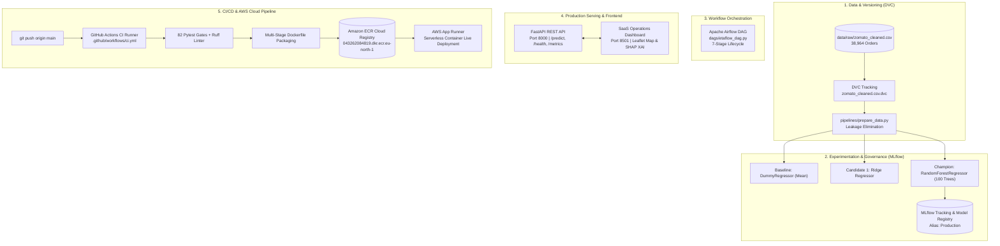

# ETAFlow: End-to-End MLOps Platform & Team Setup Guide

**Project Name:** ETAFlow — Smart Food Delivery ETA Intelligence & MLOps Platform  
**Target Organization:** Zomato Delivery Logistics (Bengaluru Network)  
**GitHub Repository:** [github.com/chinmayeechoudhari/ETAFlow-Food-Delivery-Intelligence](https://github.com/chinmayeechoudhari/ETAFlow-Food-Delivery-Intelligence.git)  
**Active Branch:** `main`  
**Current Test Status:** 82 / 82 Automated Test Gates Passing (100% Green)  
**Cloud Registry:** Amazon ECR (`eu-north-1`, Stockholm) — `043262084819.dkr.ecr.eu-north-1.amazonaws.com/etaflow-delivery-api:latest`  

---

## 1. Executive Summary & Problem Statement

### The Real-World Industry Problem:
In hyper-local food delivery networks like Zomato in Bengaluru, delivering realistic Estimated Time of Arrival (ETA) promises at checkout is mission-critical:
- **Underestimating ETA (Late Deliveries):** Results in customer frustration, cold food complaints, order cancellations, and customer support refunds.
- **Overestimating ETA (Inflated Buffers):** Discourages hungry users from placing orders, causing severe cart abandonment.

### The Technical Challenge:
Most academic ETA models suffer from **target leakage** or **lookahead bias** — they use features that are only known *after* the order is picked up (such as courier ratings, rider age, vehicle condition, or actual preparation timestamps). 

### The Solution:
ETAFlow is a production-grade, leak-free MLOps system that operates strictly at the **booking-time moment** (checkout confirmation). It combines spatial Haversine distance calculations, non-linear traffic congestion curves, dinner peak surges, and festival flags to generate reliable doorstep promises with real-time **Explainable AI (TreeSHAP)** factor attribution.

---

## 2. Complete Architecture & What Has Been Implemented



### Feature Implementation Matrix:
1. **Machine Learning Pipeline (`src/etaflow` & `pipelines/`):**
   - **Baseline:** `dummy_regressor` (Mean prediction: 26.6 min, RMSE: 9.38 min).
   - **Linear Candidate:** `ridge_regressor` (RMSE: 6.42 min, R²: 0.531).
   - **Production Champion:** `random_forest_regressor` (100 trees, RMSE: **4.18 min**, MAE: **3.24 min**, R²: **0.802**).
2. **Explainable AI (TreeSHAP):**
   - Decomposes every prediction into human-understandable minute adjustments (`+` or `-` minutes for distance, dinner hour rush, weekend cadence, festival congestion, and city density).
3. **High-Performance REST API (`src/etaflow/api/`):**
   - FastAPI server with endpoints: `/predict`, `/batch_predict`, `/health`, `/metrics`, and `/docs` (Swagger UI).
   - Sub-50ms inference latency SLA.
4. **Operations Web Dashboard (`app/`):**
   - Modern SaaS UI with 12 popular Bengaluru restaurant presets + custom coordinate input drawer.
   - Interactive Leaflet.js road routing with live map pin dragging.
   - Animated calculation feedback focusing user attention on the predicted ETA card.
5. **Quality Assurance & Governance:**
   - **82 automated Pytest test gates** covering model accuracy, anti-leakage rejection, drift detection, and latency benchmarks.
   - Official **Model Card** (`docs/model_card.md`) and **Data Card** (`docs/data_card.md`).
6. **Workflow & Data Versioning:**
   - **Apache Airflow DAG** (`dags/etaflow_dag.py`) covering all 7 stages from ingestion to model registration.
   - **DVC (Data Version Control)** metadata (`dvc.yaml`, `data/raw/zomato_cleaned.csv.dvc`).
   - **Monitoring:** Prometheus scrape configuration (`monitoring/prometheus.yml`) and production Grafana dashboard JSON (`monitoring/grafana_dashboard.json`).

---

## 3. The AWS Cloud & Amazon ECR Implementation Flow

Here is the exact story of how Docker and AWS Cloud are implemented in this project:

### A. What is Docker's Role Here?
Instead of hoping the code runs on different laptops with different operating systems, our [`Dockerfile`](Dockerfile) bundles Python 3.11, Scikit-Learn, FastAPI, the trained Random Forest model, and the frontend into an immutable Linux container equipped with an automated self-healing health check probe (`HEALTHCHECK /health`).

### B. What is Amazon ECR?
**Amazon ECR (Elastic Container Registry)** is AWS's private, highly secure cloud storage warehouse for Docker containers. 
- **Registry Location:** `eu-north-1` (Stockholm region).
- **Repository Name:** `etaflow-delivery-api`.
- **Repository URI:** `043262084819.dkr.ecr.eu-north-1.amazonaws.com/etaflow-delivery-api`.

### C. How the Automated CI/CD Pipeline Works:
1. A developer pushes code: `git push origin main`.
2. **GitHub Actions** (`.github/workflows/ci.yml`) triggers automatically on an Ubuntu cloud runner.
3. **Stage 1 (Quality Gates):** Executes Ruff code linting, runs all **82 Pytest tests**, benchmarks latency, and runs the Responsible AI fairness audit.
4. **Stage 2 (AWS Delivery):** 
   - Authenticates securely with AWS using IAM credentials (`AWS_ACCESS_KEY_ID`, `AWS_SECRET_ACCESS_KEY`).
   - Logs into Amazon ECR via `aws-actions/amazon-ecr-login`.
   - Builds the production Docker image.
   - Tags the image with both the commit SHA and `:latest`.
   - Automatically pushes the container to Amazon ECR.
5. **Verification:** All 5 workflow runs on GitHub Actions are **100% Green (✓)**.

---

## 4. How to Run the Project Locally (Setup Guide)

### Prerequisites:
- Python 3.11 installed.
- Git installed.

### Step 1: Clone the Repository
```bash
git clone https://github.com/chinmayeechoudhari/ETAFlow-Food-Delivery-Intelligence.git
cd ETAFlow-Food-Delivery-Intelligence
```

### Step 2: Set Up Virtual Environment & Dependencies
```bash
# Create virtual environment
python -m venv .venv

# Activate virtual environment
# On Windows (PowerShell):
.\.venv\Scripts\Activate.ps1
# On Mac/Linux:
source .venv/bin/activate

# Install dependencies in editable mode
pip install -e ".[dev]" mlflow
```

### Step 3: Run the Project with 1 Click
- **On Windows:** Simply double-click **`start.bat`** (or run `.\start.bat` in terminal).
- **On Mac/Linux:** Run `bash start.sh`.

*What this does automatically:*
1. Starts the FastAPI Prediction API on `http://127.0.0.1:8000`.
2. Starts the Web Operations Dashboard on `http://127.0.0.1:8501`.
3. Opens your default web browser directly to the dashboard.

---

### Step 4: Running Manually (If Preferred)

If you prefer opening two separate terminal windows:

#### Terminal 1 — Backend API:
```bash
python pipelines/serve_api.py
```
- API Health Status: `http://127.0.0.1:8000/health`
- Interactive Swagger API Docs: `http://127.0.0.1:8000/docs`

#### Terminal 2 — Operations Dashboard:
```bash
python -m http.server 8501 --directory app
```
- Open in browser: `http://127.0.0.1:8501`

---

### Step 5: Run Automated Tests & Verifications
To run all 82 automated test gates:
```bash
pytest -q
```
To run the full end-to-end MLOps pipeline locally:
```bash
python scripts/run_full_mlops_workflow.py
```

---

## 5. How to Deploy Live on AWS (AWS App Runner)

Because your Docker image is already stored and verified inside Amazon ECR, spinning up a live 24/7 web server takes **only 3 minutes**:

1. Log in to [AWS Management Console](https://console.aws.amazon.com/).
2. Make sure your top-right region is **`Europe (Stockholm)` (`eu-north-1`)**.
3. In the search bar, search **`App Runner`** $\to$ click **Create service**.
4. **Source:**
   - Type: `Container registry`
   - Provider: `Amazon ECR`
   - Image URI: Click **Browse** $\to$ choose `etaflow-delivery-api` $\to$ tag `latest`.
   - Deployment trigger: Select **Automatic** (so new git pushes automatically update the live server).
   - ECR access role: Choose **Create new service role**.
   - Click **Next**.
5. **Configuration:**
   - Service name: `etaflow-service`
   - Port: Change to **`8000`** *(FastAPI port)*.
   - Health check path: Change `/` to **`/health`**.
   - Click **Next** $\to$ click **Create & deploy**.
6. **Result:** In 2 minutes, AWS provides your **Default domain URL** (e.g., `https://xxxxxx.eu-north-1.awsapprunner.com`).

### How to Pause the Server (Zero Cost When Idle):
- In the AWS App Runner console, click your service $\to$ click **Actions** (top right) $\to$ **Pause service**.
- The server stops immediately and charges **$0.00 / hour**.
- Whenever you have a viva or presentation, click **Actions $\to$ Resume service**, and it will be back online in 45 seconds!

---

## 6. Key Documentation Reference Index

| File | Purpose |
| :--- | :--- |
| [`docs/model_card.md`](docs/model_card.md) | Official Model Card with hyperparameters, metrics, and ethical statements. |
| [`docs/data_card.md`](docs/data_card.md) | Data Card with feature availability and anti-leakage tiers. |
| [`docs/AWS_CICD_DEPLOYMENT_GUIDE.md`](docs/AWS_CICD_DEPLOYMENT_GUIDE.md) | In-depth AWS architecture, IAM permissions, and viva defense Q&A script. |
| [`dags/etaflow_dag.py`](dags/etaflow_dag.py) | Apache Airflow DAG script defining the 7-stage ML pipeline. |
| [`monitoring/grafana_dashboard.json`](monitoring/grafana_dashboard.json) | Production Grafana monitoring dashboard configuration. |
| [`.github/workflows/ci.yml`](.github/workflows/ci.yml) | GitHub Actions CI/CD automation workflow with Amazon ECR delivery. |
